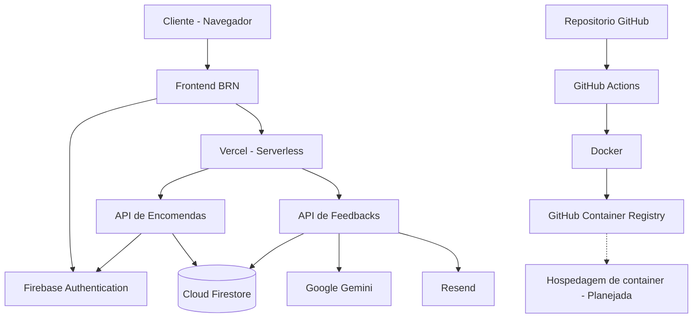

# BRN Transportes e Logística

### Projeto Cloud Feedbacks — Computação em Nuvem

**Instituição:** Centro Universitário Nobre (UNIFAN)  
**Curso:** Análise e Desenvolvimento de Sistemas  
**Disciplina:** Computação em Nuvem  
**Professor:** Rafael Levi Batista Costa  
**Semestre:** 2026.2

### Integrantes da equipe

- Bruno Alexandre
- Gustavo Campinho
- João Gabriel Leôncio
- Fred Borges

---

## 1. Apresentação do projeto

O Projeto Cloud Feedbacks foi desenvolvido pela nossa equipe como parte das atividades avaliativas da disciplina de Computação em Nuvem.

Nossa proposta inicial era desenvolver uma aplicação capaz de receber comentários de usuários e utilizar inteligência artificial para identificar se esses feedbacks eram positivos, negativos ou neutros.

Durante o desenvolvimento, percebemos que poderíamos aplicar essa ideia a um cenário mais próximo de uma situação empresarial. Foi assim que surgiu a BRN Transportes e Logística, uma transportadora fictícia inspirada em experiências com empresas virtuais de transporte no jogo Euro Truck Simulator 2.

Com essa mudança, conseguimos dar um contexto mais definido ao sistema de feedbacks. Em vez de apenas receber comentários isolados, nossa aplicação passou a relacionar a opinião dos clientes com os serviços prestados por uma transportadora.

A proposta é permitir que os usuários acompanhem suas encomendas, consultem informações sobre o transporte e, após a entrega, possam avaliar a experiência.

Essas avaliações serão utilizadas para alimentar o sistema de análise de sentimentos, ajudando a identificar problemas recorrentes e oportunidades de melhoria.

É importante destacar que a BRN Transportes e Logística é uma empresa fictícia, criada exclusivamente para fins acadêmicos.

## 2. Objetivos

Nosso principal objetivo é demonstrar a aplicação prática de conceitos de computação em nuvem por meio de um sistema web integrado a diferentes serviços.

Para isso, buscamos:

- Desenvolver uma aplicação acessível pelo navegador.
- Implementar autenticação de usuários.
- Armazenar informações utilizando um banco de dados em nuvem.
- Criar APIs para comunicação entre o frontend e o backend.
- Integrar inteligência artificial para análise de feedbacks.
- Utilizar Docker para conteinerizar a aplicação.
- Automatizar testes e a construção de imagens com GitHub Actions.
- Documentar a arquitetura, a segurança, os custos e a escalabilidade do sistema.

Além desses objetivos, pretendemos demonstrar como a análise de feedbacks pode ajudar uma empresa a compreender melhor a experiência de seus clientes.

## 3. Tecnologias utilizadas

Durante o desenvolvimento, utilizamos diferentes tecnologias, escolhidas de acordo com as necessidades do projeto.

| Tecnologia | Utilização |
|---|---|
| HTML | Estrutura das páginas |
| CSS | Estilização e responsividade |
| JavaScript | Funcionalidades e interação |
| Node.js | Execução das APIs |
| Vercel | Hospedagem e funções serverless |
| Firebase Authentication | Cadastro e autenticação |
| Cloud Firestore | Armazenamento dos dados |
| Firebase Admin SDK | Comunicação segura do backend com o Firebase |
| Google Gemini API | Análise de sentimentos dos feedbacks |
| Resend | Envio de alertas por e-mail |
| Docker | Conteinerização da aplicação |
| GitHub | Versionamento do projeto |
| GitHub Actions | Automação de testes e construção |
| GitHub Container Registry | Armazenamento das imagens Docker |

Optamos por uma arquitetura baseada principalmente em serviços gerenciados e funções serverless, pois isso facilita a implementação de uma aplicação acadêmica sem exigir a administração direta de servidores.

Também utilizamos Docker para demonstrar uma alternativa de execução da aplicação em contêineres.

## 4. Arquitetura da aplicação

Nossa aplicação foi organizada em frontend, backend e serviços externos.

O frontend é responsável pelas páginas acessadas pelo usuário. O backend recebe as requisições, realiza as verificações necessárias e se comunica com o banco de dados e os demais serviços.

### Diagrama da arquitetura



No funcionamento atual, utilizamos a Vercel para executar as APIs em um ambiente serverless.

Também desenvolvemos uma versão conteinerizada da aplicação, utilizando um servidor Node.js próprio. Essa versão foi testada localmente com Docker.

O GitHub Actions realiza a construção, os testes e a publicação da imagem Docker no GitHub Container Registry.

A implantação automatizada dessa imagem em um serviço específico de hospedagem de contêineres ainda não foi implementada.

## 5. Desenvolvimento do sistema

### 5.1. Interface web

Criamos o site da BRN Transportes com páginas voltadas à apresentação da empresa, seus serviços e o acesso dos clientes.

As páginas utilizam HTML, CSS e JavaScript, com suporte a diferentes tamanhos de tela e adaptação visual para temas claros e escuros.

Também desenvolvemos uma área exclusiva para usuários cadastrados.

### 5.2. Autenticação

Para implementar o cadastro e o login, escolhemos o Firebase Authentication.

O sistema permite que um usuário crie sua conta com e-mail e senha, receba uma mensagem de verificação e realize a autenticação.

Também implementamos a recuperação de senha.

Depois de confirmar o e-mail e realizar o login, o cliente pode acessar seu painel.

O Firebase utiliza tokens de autenticação que são verificados pelo backend nas rotas protegidas.

Durante nossos testes, conseguimos realizar o cadastro, confirmar o e-mail e acessar o painel com sucesso.

### 5.3. Rastreamento de encomendas

Utilizamos o Cloud Firestore para armazenar informações sobre encomendas.

Entre os dados registrados estão:

- Código de rastreamento.
- Identificação do cliente.
- Origem.
- Destino.
- Status do transporte.
- Previsão de entrega.
- Confirmação de entrega.

Conseguimos cadastrar uma encomenda fictícia no Firestore e exibi-la no painel do usuário autenticado.

A consulta é realizada por uma API que verifica a identidade do usuário e busca as encomendas vinculadas à sua conta.

Esse mecanismo é importante para evitar que um cliente consulte informações de outros usuários.

O histórico detalhado das movimentações e o cadastro de encomendas pelo painel administrativo fazem parte das próximas etapas.

### 5.4. Sistema de feedbacks

O sistema de feedbacks é a funcionalidade central do nosso projeto.

Desenvolvemos uma API em Node.js que recebe um comentário e envia seu conteúdo para análise utilizando a API do Google Gemini.

A inteligência artificial interpreta o texto e retorna uma classificação de sentimento:

- Positivo.
- Negativo.
- Neutro.

Também é realizada uma classificação por categoria, como atendimento, entrega, qualidade do produto e outras situações.

Os resultados são armazenados no Cloud Firestore.

Nos casos de feedback negativo, a aplicação possui uma integração com o Resend para envio de alertas por e-mail, quando o serviço está devidamente configurado.

A API de análise já foi implementada. Entretanto, a integração definitiva com o formulário de avaliação das entregas e a autenticação obrigatória desse endpoint ainda precisam ser concluídas.

### 5.5. BRN Rewards

Como evolução do projeto, planejamos um sistema de recompensas chamado BRN Rewards.

Nossa ideia é incentivar os clientes a responder às pesquisas de satisfação após receberem suas encomendas.

O cliente poderá ganhar pontos fictícios por participar, independentemente de sua avaliação ser positiva, negativa ou neutra.

Escolhemos esse modelo porque não queremos incentivar apenas comentários positivos. O objetivo do projeto é obter opiniões sinceras que possam ser analisadas pela inteligência artificial.

O BRN Rewards ainda está em desenvolvimento e não realiza concessões reais de pontos ou benefícios.

## 6. Banco de dados

Escolhemos o Cloud Firestore, um banco de dados NoSQL orientado a documentos.

Consideramos essa alternativa adequada porque nossa aplicação trabalha com informações que podem variar entre encomendas, usuários e avaliações.

Além disso, o Firestore possui integração com o ecossistema Firebase utilizado no projeto.

### Coleções utilizadas

**encomendas**

Armazena os dados das entregas e a identificação do usuário responsável pela encomenda.

**feedbacks**

Armazena os comentários e as classificações produzidas pela inteligência artificial.

### Estruturas planejadas

Pretendemos ampliar a organização dos dados para incluir históricos de movimentações, perfis de empresas parceiras e pontuações do BRN Rewards.

## 7. Segurança da aplicação

A segurança é uma das partes que estamos priorizando após as orientações recebidas na primeira etapa do trabalho.

Implementamos autenticação por meio do Firebase Authentication e validação de tokens na API de encomendas.

Também utilizamos variáveis de ambiente para armazenar as credenciais necessárias às integrações externas.

Essas informações não devem ser incluídas diretamente no código-fonte público.

As regras atuais do Firestore bloqueiam leituras e escritas diretas feitas por aplicativos clientes. O acesso administrativo ao banco é realizado pelo backend utilizando o Firebase Admin SDK.

Por esse motivo, reconhecemos a importância de validar as permissões dentro das próprias APIs, já que o Admin SDK não depende das regras de segurança aplicadas aos clientes do Firestore.

### Medidas implementadas

- Autenticação de usuários pelo Firebase.
- Verificação de e-mail.
- Validação de tokens na API de encomendas.
- Consulta de encomendas vinculadas ao UID autenticado.
- Utilização de variáveis de ambiente.
- Arquivos sensíveis protegidos por configurações do Git e do Docker.
- Execução do contêiner com usuário não root.

### Melhorias de segurança previstas

- Proteger a API de feedbacks com autenticação.
- Separar permissões de clientes, empresas e administradores.
- Implementar limitação de requisições.
- Revisar as vulnerabilidades das dependências.
- Documentar a estratégia de DNS e proteção de borda.
- Revisar as credenciais utilizadas durante o desenvolvimento.

## 8. Conteinerização com Docker

Uma das melhorias solicitadas pelo professor foi a implementação do Docker.

Para atender a essa exigência, criamos um servidor Node.js capaz de executar a aplicação fora do ambiente serverless da Vercel.

Em seguida, desenvolvemos um Dockerfile utilizando uma imagem do Node.js 22 baseada em Alpine Linux.

O Dockerfile realiza a instalação das dependências, copia os arquivos necessários e define como a aplicação será iniciada.

Também criamos um arquivo `.dockerignore` para impedir que arquivos desnecessários ou sensíveis sejam incorporados à imagem.

### Testes realizados

Inicialmente, construímos a imagem Docker no Ubuntu.

Depois, iniciamos o contêiner e verificamos o funcionamento do servidor pelo endpoint `/health`.

Também acessamos a página inicial da BRN pelo navegador.

Durante os testes, identificamos dificuldades relacionadas ao carregamento das credenciais do Firebase. Após corrigirmos a configuração das variáveis de ambiente, conseguimos executar o sistema no Docker e consultar uma encomenda no Firestore.

Esses testes demonstraram que a aplicação pode funcionar em um ambiente conteinerizado.

### Construção da imagem

```bash
sudo docker build -t brn-transportes:1.0 .
```

### Execução do contêiner

```bash
sudo docker run --rm \
  --name brn-teste \
  --env-file .env \
  -p 3001:3000 \
  brn-transportes:1.0
```

### Endereços de teste

Página inicial:

http://localhost:3001/home.html

Verificação do servidor:

http://localhost:3001/health

As credenciais devem ser fornecidas por variáveis de ambiente, sem serem incluídas na imagem Docker.

## 9. Integração contínua e entrega contínua

Após a implementação do Docker, configuramos o GitHub Actions para automatizar parte do processo de desenvolvimento.

Criamos o arquivo:

`.github/workflows/docker-ci.yml`

O pipeline é executado quando enviamos alterações para as branches configuradas no repositório.

### Etapas do pipeline

1. O GitHub Actions obtém o código do repositório.
2. O ambiente Docker é preparado.
3. A imagem da aplicação é construída.
4. Um contêiner de teste é iniciado.
5. O endpoint `/health` é consultado.
6. A página inicial é testada.
7. A imagem é enviada ao GitHub Container Registry.

Conseguimos executar o pipeline com sucesso no GitHub Actions.

A automação permite verificar se a aplicação continua inicializando corretamente após alterações no repositório.

Entretanto, os testes atuais ainda não verificam todas as funcionalidades da aplicação, como autenticação e análise de feedbacks.

### Publicação da imagem

Utilizamos o GitHub Container Registry para armazenar as imagens geradas.

Registro:

`ghcr.io/alexandrebruno324-eng/projeto-cloud-feedbacks`

A imagem é identificada por tags relacionadas à branch e ao commit.

A publicação no Registry já está automatizada. O deploy automático do contêiner em um serviço de hospedagem ainda será desenvolvido ou documentado como proposta de implantação.

### Evidência da execução

https://github.com/alexandrebruno324-eng/projeto-cloud-feedbacks/actions/runs/43756514779

## 10. Endpoints da aplicação

| Método | Rota | Descrição |
|---|---|---|
| GET | /health | Verifica o funcionamento do servidor Node.js |
| GET | /api/encomendas | Consulta as encomendas do usuário autenticado |
| POST | /api/feedback | Recebe comentários e realiza análise de sentimentos |

O endpoint `/health` está disponível na execução pelo servidor Node.js utilizado no Docker.

As demais rotas correspondem às APIs desenvolvidas para o projeto.

A API de feedbacks ainda necessita de controles adicionais de autenticação e autorização.

## 11. Execução local

Para executar o projeto, é necessário possuir Node.js, npm e as credenciais dos serviços utilizados.

### Instalar as dependências

```bash
npm ci
```

### Executar com Vercel

```bash
npx vercel dev
```

O endereço local normalmente utiliza a porta 3000.

Exemplo:

http://localhost:3000/home.html

### Variáveis de ambiente

| Variável | Utilização |
|---|---|
| FIREBASE_PROJECT_ID | Identificação do projeto Firebase |
| FIREBASE_CLIENT_EMAIL | Conta de serviço do Firebase |
| FIREBASE_PRIVATE_KEY | Chave privada do Firebase |
| GEMINI_API_KEY | Acesso ao Gemini |
| RESEND_API_KEY | Acesso ao Resend |
| ALERT_EMAIL_TO | Destinatário dos alertas |
| RESEND_FROM_EMAIL | Remetente dos alertas |

Os valores verdadeiros dessas variáveis não devem ser publicados no GitHub.

## 12. Planejamento de escalabilidade

A escalabilidade é um dos pontos que precisamos aprofundar conforme as orientações do professor.

Nossa aplicação utiliza funções serverless na Vercel, o que permite que parte da infraestrutura seja gerenciada automaticamente pelo provedor.

Entretanto, sabemos que isso não significa capacidade ilimitada.

O desempenho depende do volume de requisições, do tempo de execução das funções, das operações no Firestore e das chamadas à API Gemini.

Nossa equipe pretende definir faixas específicas de requisições por segundo (RPS), separando cenários de utilização normal, aumento de acessos e picos de demanda.

Também precisaremos considerar estratégias como limitação de requisições, otimização das consultas e controle das chamadas à inteligência artificial.

As faixas definitivas e os resultados dos testes de carga serão apresentados no relatório de escalabilidade.

## 13. Custos e utilização dos planos gratuitos

Durante o desenvolvimento, buscamos utilizar serviços com planos gratuitos para reduzir os custos do projeto.

Entretanto, entendemos que esses planos possuem limites e que uma aplicação em produção pode gerar despesas conforme o crescimento do uso.

Nosso relatório de custos deverá considerar:

- Execução das funções da Vercel.
- Armazenamento e operações no Firestore.
- Utilização do Firebase Authentication.
- Chamadas à API Gemini.
- Envio de mensagens pelo Resend.
- Armazenamento de imagens no GitHub Container Registry.
- Possíveis custos de hospedagem de contêineres.

Também serão apresentadas as cotas gratuitas dos serviços utilizados, os cenários de consumo e as medidas para evitar cobranças inesperadas.

A análise financeira detalhada ainda está em preparação.

## 14. Dificuldades encontradas

Durante o desenvolvimento, enfrentamos algumas dificuldades que contribuíram para nossa compreensão dos serviços utilizados.

Uma delas foi configurar corretamente a comunicação entre o backend e o Firebase, principalmente no carregamento das credenciais por variáveis de ambiente.

Também precisamos organizar a estrutura do Firestore para vincular as encomendas aos usuários autenticados.

Na etapa de conteinerização, instalamos o Docker no Ubuntu, construímos a imagem e realizamos testes para identificar problemas de configuração.

Posteriormente, configuramos o GitHub Actions e verificamos a execução automática dos testes.

Essas etapas ajudaram nossa equipe a compreender melhor a relação entre desenvolvimento de software, infraestrutura em nuvem, segurança e automação.

## 15. Melhorias previstas

Ainda pretendemos implementar e aprimorar algumas funcionalidades:

- Histórico completo de movimentações das encomendas.
- Painel administrativo.
- Cadastro e acompanhamento de empresas parceiras.
- Avaliações vinculadas às entregas concluídas.
- Integração completa do feedback com o Gemini.
- Programa BRN Rewards.
- Testes automatizados adicionais.
- Testes de carga e escalabilidade.
- Relatório completo de custos e segurança.
- Documentação de DNS e implantação em nuvem.
- Automação de deploy em um ambiente de contêineres.

Nossa prioridade atual é concluir os requisitos técnicos definidos para a avaliação da disciplina.

## 16. Considerações finais

O desenvolvimento da BRN Transportes permitiu que nossa equipe aplicasse diferentes conhecimentos relacionados à Computação em Nuvem.

Começamos com uma proposta de análise de sentimentos e evoluímos para um sistema de transporte fictício que utiliza autenticação, banco de dados em nuvem, APIs e inteligência artificial.

Além do desenvolvimento web, conseguimos trabalhar com Docker e GitHub Actions, realizando testes locais e automatizando a construção e publicação das imagens da aplicação.

Ainda temos melhorias a implementar, principalmente relacionadas à segurança, escalabilidade e documentação financeira.

Mesmo assim, o projeto já nos proporcionou uma experiência prática importante sobre a integração de diferentes tecnologias e sobre os desafios encontrados no desenvolvimento de aplicações em nuvem.

---

**BRN Transportes e Logística — Projeto acadêmico fictício.**

**Equipe 3 — Projeto Cloud Feedbacks — 2026.2**
